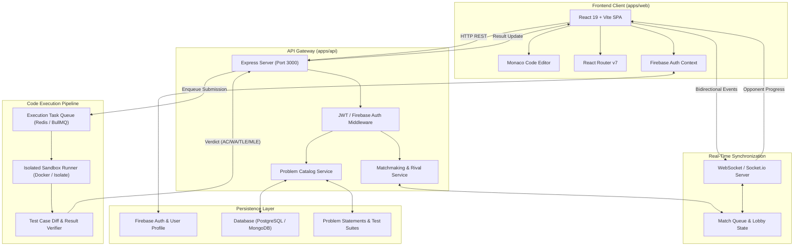

# BrackeT — System Architecture & Design Document

> **Platform Vision**: *"More than solving problems. Play the match."*  
> BrackeT transforms algorithmic practice into a high-stakes, real-time competitive battleground where developers sharpen their logic through head-to-head duels, ladder progression, and a modern in-browser coding arena.

---

## 1. Executive Summary & Core Concept

Traditional competitive programming and interview preparation platforms are solitary, asynchronous, and sterile. Developers solve problems in isolation without the pressure, excitement, or pacing demanded by real-world tech interviews and coding competitions.

**BrackeT** reimagines this paradigm by introducing:
- **1v1 Rival Duels**: Matched players solve the same problem simultaneously with live status tracking.
- **Ranked Rating (RR) Ladder**: An Elo-inspired tier progression system spanning Bronze to Champion.
- **Split-Panel Coding Arena**: A high-performance IDE built with Monaco Editor, customizable layout panels, multi-language compilation targets, and integrated test runner.
- **High-Aesthetic Dark UI**: A cyberpunk-inspired, dark-mode design system with fluid micro-animations (Framer Motion, Magic UI, Tailwind CSS v4).

---

## 2. Monorepo & System Architecture

BrackeT is engineered as an npm-workspaces monorepo designed to scale independently across frontend clients, API gateways, execution workers, and shared packages.

### 2.1 Workspace Structure

```
BrackeT/
├── apps/
│   ├── web/               # React 19 + TypeScript + Vite + Tailwind CSS v4
│   └── api/               # Express + TypeScript backend gateway & services
├── packages/              # Shared libraries (future: types, judge-client, ui)
├── design.md              # System architecture & design specifications
├── progress.md            # Development tracker & milestone roadmap
├── README.md              # Project overview & quickstart guide
└── package.json           # Root workspace configuration
```

### 2.2 High-Level Architecture Diagram



---

## 3. Frontend Architecture (`apps/web`)

The frontend application delivers an interactive web experience with low latency, responsive editor resizing, and interactive animations.

### 3.1 Tech Stack & Core Libraries

| Technology | Role | Version |
| :--- | :--- | :--- |
| **React** | Reactive UI framework | `^19.2.8` |
| **TypeScript** | Type safety across components & domain models | `~6.0.2` |
| **Vite** | Blazing-fast build tool and development server | `^8.3.0` |
| **Tailwind CSS v4** | Utility-first CSS engine with modern theme tokens | `^4.3.3` |
| **React Router** | Client-side routing, loaders, and error boundaries | `^7.18.3` |
| **Monaco Editor** | Industrial-grade code editor (powers VS Code) | `^0.57.0` |
| **Framer Motion** | Physics-based animations, layout transitions | `^13.4.0` |
| **Firebase** | Authentication (Email/Password, Google OAuth) | `^12.19.0` |
| **React Resizable Panels** | Fluid split-panel workspace layouts | `^4.14.1` |

### 3.2 Design System & Visual Tokens

The UI embraces a sleek dark aesthetic designed to reduce eye strain during long coding sessions while highlighting competitive tension with high-contrast accent colors.

- **Theme Colors**:
  - **Background (`--background`)**: `#0E1011` (Deep Charcoal Black)
  - **Surface / Card (`--card`)**: `#061327` (Midnight Blue Slate)
  - **Primary (`--primary`)**: `#0052d8` (Cobalt Blue)
  - **Secondary (`--secondary`)**: `#4bc69d` (Neon Mint)
  - **Accent (`--accent`)**: `#dffb15` (Electric Volt Yellow)
  - **Foreground (`--foreground`)**: `#ffffff` (Pure White) with stepped opacities
- **Typography**:
  - Body Text: `Montserrat`
  - Headings: `Hind Siliguri`
  - Code & Badges: `JetBrains Mono`

### 3.3 Application Layouts

1. **Root Layout (`RootLayout`)**:
   - Sticky navigation header with brand Aurora logo, responsive links (Home, Problems, Rival, Interview, About), and user profile dropdown.
   - Dynamic `<Outlet />` mounting point for content pages.
   - Footer with platform links, copyright, and social connections.
2. **Authentication Layout (`AuthLayout`)**:
   - Split-screen cinematic design.
   - Left side: Dynamic glyph matrix canvas, falling meteors, and rotating typewriter badges.
   - Right side: Clean, focused form container for Login and Registration flows.

---

## 4. Key Functional Modules

### 4.1 Landing Page Experience (`/`)
- **Hero Section**: Value proposition ("Unlock Your Potential Through Competitive Coding"), primary CTA buttons, dynamic animated background grid, and high-production promo video dialog with glowing border beams.
- **How It Works**: Visualized workflow (Queue → Code → Climb) leveraging interactive SVG `AnimatedBeam` connectors.
- **Rank Tier Showcase**: Introduction of the competitive ladder with 3D-styled tier emblems and floating animations.
- **Language Showcase**: Double-ring `OrbitingCircles` highlighting multi-language capabilities (C++, Python, JavaScript, TypeScript, Go, Java, PHP, C).
- **Bento Feature Grid**: Highlights interactive code arena, live head-to-head duels, ladder progression, and match statistics.
- **FAQ Section**: Accordion explaining platform rules, duel mechanics, and ranking algorithms.

### 4.2 Problem Catalog (`/problems`)
- **Categorization**: Filter problems by category tabs (`All Topics`, `Data Structures`, `Algorithms`, `Database`, `Shell`).
- **Search & Sort**: Real-time problem filtering by name, tag, and difficulty rating.
- **Problem Table**: Displays problem title, numerical skill rating (e.g., 950 RR), tags, and historical acceptance rate.
- **Loader**: Client loader fetching structured problem manifests (`/mockProblems.json` transitioning to API endpoints).

### 4.3 Problem Solving Arena (`/problem/details/:slug`)
- **Workspace Navigation Bar**:
  - Logo and quick return to problem catalog.
  - Action controls: Problem timer stopwatch, random problem shuffle button.
  - Execution controls: "Run" (evaluates visible sample cases) and "Submit" (evaluates hidden test cases).
  - User session and profile avatar.
- **Split Resizable Panels (`react-resizable-panels`)**:
  - **Left Panel (Problem Statement)**:
    - Title, difficulty rating badge, topic tags.
    - Markdown-rendered problem description, input/output formats, and constraints.
    - Example blocks with copyable sample inputs, expected outputs, and explanations.
  - **Right Panel (Top: Code Editor)**:
    - Monaco Editor integration configured with `vs-dark` theme.
    - Dynamic language switcher (C++, Python, JavaScript, TypeScript, Java, Go).
    - Starter code boilerplate tailored to each language and problem signature.
    - Utility buttons for code formatting and resetting to default code.
  - **Right Panel (Bottom: Test Suite Console)**:
    - Tabs for sample test cases, custom input editor, and execution results.
    - Console outputs: stdout, stderr, execution time (ms), memory consumption (MB), and test verdict diff.

### 4.4 Authentication & User Management
- Handled via Firebase Authentication with centralized React context (`AuthProvider`).
- Supported providers: Email + Password and Google One-Tap/Popup sign-in.
- State persists across page refreshes with real-time auth state observer (`onAuthStateChanged`).

---

## 5. Backend & Real-Time Duel Architecture (`apps/api` & Beyond)

### 5.1 API Gateway Structure
The backend currently runs an Express server in TypeScript with CORS and JSON parsing enabled, structured to serve:
- `/api/problems`: Problem catalog, problem statements, and metadata.
- `/api/auth/verify`: Token verification and user session syncing.
- `/api/submissions`: Code submission intake and status polling.
- `/api/leaderboard`: Player ratings, match records, and rank tier distributions.

### 5.2 1v1 Rival Duel System (Planned)

```
[Player A: Queue Up] \
                      ---> [Matchmaking Queue] ---> [Match Found & Accepted]
[Player B: Queue Up] /                                       |
                                                             v
[Live Duel Arena] <================================ [WebSocket Room]
  - Synchronized Problem Assignment
  - Live Opponent Status (Editing / Running / Submitted)
  - Head-to-Head Clock Countdown
  - Instant Verdict Broadcasting (Win / Loss / Draw)
```

- **Rating Model**:
  - ELO / Glicko-2 derived Ranked Rating (`RR`).
  - Win delta calculated based on opponent's rating and problem difficulty.
  - Bonus RR awarded for rapid submissions with zero test failures.

### 5.3 Code Execution & Sandboxing Pipeline

To execute untrusted user code safely:
1. **Containerized Sandbox**: Run submissions inside hardened, ephemeral containers (e.g., Docker, Judge0, or Linux `isolate` / `nsjail` cgroups).
2. **Resource Constraints**:
   - CPU Time Limit: 1.0 – 2.0 seconds (customizable per language).
   - Memory Limit: 256 MB.
   - Disk/Network: Complete network isolation, readonly file systems with ephemeral `/tmp`.
3. **Verdict Classification**:
   - `AC` — Accepted (All test cases passed).
   - `WA` — Wrong Answer (Output mismatch).
   - `TLE` — Time Limit Exceeded.
   - `MLE` — Memory Limit Exceeded.
   - `RTE` — Runtime Error (Null pointer, segmentation fault, exception).
   - `CE` — Compilation Error.

---

## 6. Security & Performance Considerations

1. **Frontend Performance**:
   - Monaco Editor lazy loading to prevent bloating the initial bundle.
   - Route-level code splitting via dynamic imports.
   - Optimized asset pipeline with WebP/SVG formats and streaming promo video delivery.
2. **API & Execution Security**:
   - Firebase JWT verification on all secured routes.
   - Rate limiting on compilation endpoints to prevent denial-of-service abuse.
   - Total isolation of user code execution from host network and filesystem.
