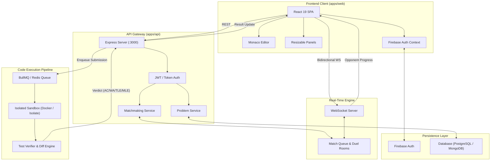
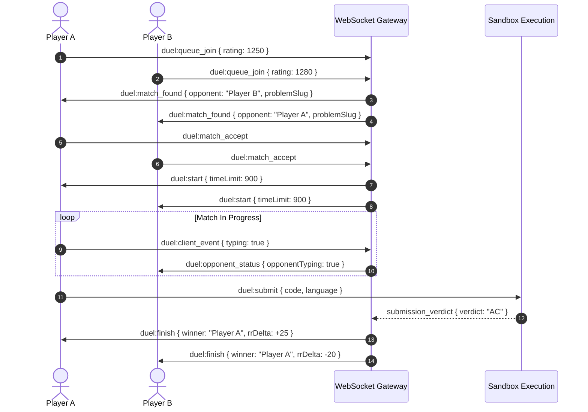

# BrackeT — System Architecture & Design Document

> **Platform Vision**: *"More than solving problems. Play the match."*  
> Real-time competitive coding battleground featuring 1v1 head-to-head duels, an in-browser Monaco coding arena, and an Elo-based Ranked Rating (RR) ladder.

---

## 1. System Architecture

BrackeT is structured as an npm-workspaces monorepo separating presentation, API routing, and execution infrastructure.

### 1.1 Monorepo Structure

```
BrackeT/
├── apps/
│   ├── web/               # React 19 + TypeScript + Vite 8 + Tailwind CSS v4 SPA
│   └── api/               # Express 5 + TypeScript API gateway & services
├── packages/              # Shared libraries (future: types, judge-client)
├── design.md              # System architecture & technical specifications
├── progress.md            # Development roadmap & milestone tracker
└── package.json           # Root workspace configuration
```

### 1.2 High-Level Architecture Diagram



---

## 2. Frontend Architecture (`apps/web`)

### 2.1 Core Stack & Design Tokens
- **Framework**: React 19, TypeScript, Vite 8, Tailwind CSS v4, React Router v7.
- **Editor**: `@monaco-editor/react` (configured with `vs-dark`).
- **Layouts**: `react-resizable-panels` for responsive multi-axis split views.
- **Theme Palette**:
  - Background: `#0E1011` (Deep Charcoal)
  - Card / Surface: `#061327` (Midnight Slate)
  - Primary: `#0052d8` (Cobalt Blue)
  - Secondary: `#4bc69d` (Neon Mint)
  - Accent: `#dffb15` (Electric Volt Yellow)
  - Foreground: `#ffffff` (Pure White)
- **Typography**: `Montserrat` (Body), `Hind Siliguri` (Headings), `JetBrains Mono` (Code & Badges).

### 2.2 Coding Arena Architecture (`/problem/details/:slug`)

The problem arena uses a dual-axis nested split panel layout:
- **Left Panel (~40% width)**:
  - Problem title, rating badge, topic tags, and acceptance rate.
  - Markdown-rendered problem description, input/output formats, and constraints.
  - Expandable sample test cases and collapsible hints.
- **Right Panel (~60% width)**:
  - **Top Panel (Editor)**: Dynamic language selector (C++, Python, JS, TS, Java, Go), starter code templates, code formatter, and Monaco Editor instance.
  - **Bottom Panel (Test Console)**: Pretest/public test case selector tabs (`Case 1`, `Case 2`, ...), input and expected output inspection blocks, and verdict display.
- **Top Toolbar**: Stopwatch problem timer, random problem shuffle, "Run" (pretests) and "Submit" (hidden test suite) action triggers.

---

## 3. Backend & Real-Time Duel Architecture (`apps/api`)

### 3.1 REST API Gateway
- `GET /api/problems`: Filtered and paginated problem catalog.
- `GET /api/problems/:slug`: Problem statement, constraints, public test cases, and language templates.
- `POST /api/submissions/run`: Ephemeral test execution against public cases.
- `POST /api/submissions/submit`: Graded submission against hidden test suite with rating updates.
- `POST /api/auth/verify`: Firebase ID token verification and profile synchronization.
- `GET /api/leaderboard`: Tiered and global ladder standings.

### 3.2 1v1 Rival Duel Protocol



### 3.3 Ranked Rating (RR) System

- **Elo Calculation**:
  $$E_A = \frac{1}{1 + 10^{(R_B - R_A) / 400}}$$
  $$R_A' = R_A + K \cdot (S_A - E_A) + B_{speed} + B_{accuracy}$$
  - $K$: Scaling factor ($K = 32$ for provisional, $K = 16$ for veteran).
  - $B_{speed}$ & $B_{accuracy}$: Bonus RR for rapid, first-attempt accepted solutions.

| Tier | RR Range | Theme Accent |
| :--- | :--- | :--- |
| **Bronze** | 0 – 799 | Rust Bronze |
| **Silver** | 800 – 1199 | Slate Silver |
| **Gold** | 1200 – 1499 | Electric Volt (`#dffb15`) |
| **Platinum** | 1500 – 1799 | Neon Mint (`#4bc69d`) |
| **Diamond** | 1800 – 2099 | Cobalt Blue (`#0052d8`) |
| **Master** | 2100 – 2399 | Deep Violet |
| **Champion** | 2400+ | Aurora Prismatic |

---

## 4. Sandboxed Code Execution Pipeline

### 4.1 Execution Sandboxing & Limits
Untrusted code is executed inside ephemeral, unprivileged container sandboxes (via Docker or Linux `isolate`/`nsjail` cgroups) with strict constraints:

| Parameter | Limit | Details |
| :--- | :--- | :--- |
| **CPU Time** | 1.0 s baseline | $\times 2$ for Java, $\times 3$ for Python |
| **Memory** | 256 MB | Hard limit via cgroups `memory.max` |
| **Processes** | Max 10 PID | Prevents fork-bombs |
| **Disk Write** | 16 MB | Ephemeral `/tmp`, root filesystem is read-only |
| **Network** | Disabled | `network: none` isolated namespace |

### 4.2 Runtime Matrix & Verdicts

| Language | Compiler / Target | Compilation | Execution |
| :--- | :--- | :--- | :--- |
| **C++** | GCC 14 | `g++ -O3 -std=c++20 solution.cpp -o solution` | `./solution` |
| **Python** | CPython 3.12 | Syntax check | `python3 solution.py` |
| **JavaScript** | Node.js 22 LTS | Syntax check | `node solution.js` |
| **TypeScript** | tsx / esbuild | `esbuild solution.ts --bundle --outfile=out.js` | `node out.js` |
| **Java** | OpenJDK 21 LTS | `javac Solution.java` | `java -Xmx256m Solution` |
| **Go** | Go 1.23 | `go build -o solution solution.go` | `./solution` |

**Verdict Classifications**:
- `AC` (Accepted): Passed all test cases within resource limits.
- `WA` (Wrong Answer): Output mismatch against expected answer.
- `TLE` (Time Limit Exceeded): CPU execution exceeded time cap.
- `MLE` (Memory Limit Exceeded): RAM consumption exceeded 256 MB.
- `RTE` (Runtime Error): Non-zero process exit code (exception/segfault).
- `CE` (Compilation Error): Syntax or type compilation failure.

---

## 5. Core Data Models

```typescript
// Problem Entity
interface Problem {
  id: string;
  slug: string;
  title: string;
  rating: number;
  tags: string[];
  statement: {
    description: string;
    inputFormat: string;
    outputFormat: string;
    notes?: string;
  };
  constraints: string[];
  timeLimitMs: number;
  memoryLimitMb: number;
  languageTimeMultiplier: Record<string, number>;
  examples: Array<{ input: string; output: string; explanation?: string }>;
  testCases: {
    public: Array<{ input: string; output: string }>;
    pretests: Array<{ input: string; output: string }>;
    hidden: Array<{ input: string; output: string }>;
  };
  allowedLanguages: string[];
  starterCode: Record<string, string>;
  hints?: string[];
}

// User Entity
interface UserProfile {
  uid: string;
  email: string;
  displayName: string;
  photoURL?: string;
  rating: number;
  tier: "Bronze" | "Silver" | "Gold" | "Platinum" | "Diamond" | "Master" | "Champion";
  stats: {
    matchesPlayed: number;
    matchesWon: number;
    matchesLost: number;
    currentStreak: number;
    problemsSolved: number;
  };
}

// Submission Entity
interface Submission {
  submissionId: string;
  userId: string;
  problemSlug: string;
  language: string;
  code: string;
  mode: "run" | "submit" | "duel";
  verdict: "AC" | "WA" | "TLE" | "MLE" | "RTE" | "CE" | "PENDING";
  executionTimeMs: number;
  memoryUsedMb: number;
  passedTests: number;
  totalTests: number;
  matchId?: string;
  createdAt: string;
}
```

---

## 6. Security & Performance Principles

1. **Sandbox Isolation**: Ephemeral execution containers with dropped Linux capabilities (`--cap-drop=ALL`), no network access, and strict PID/memory limits.
2. **Editor & Bundle Performance**: Lazy loading for Monaco Editor chunks; code-splitting on route boundaries via React Router v7.
3. **API Protection**: JWT/Firebase token validation on state-mutating endpoints; rate limiting on code execution dispatchers.
