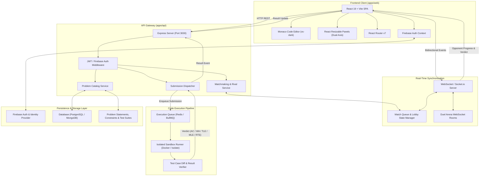
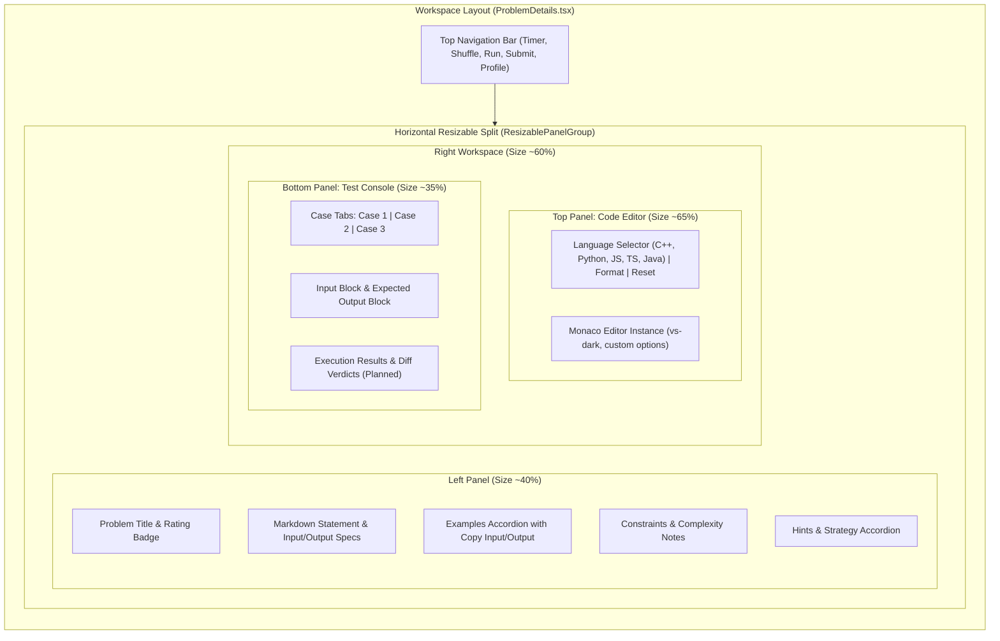
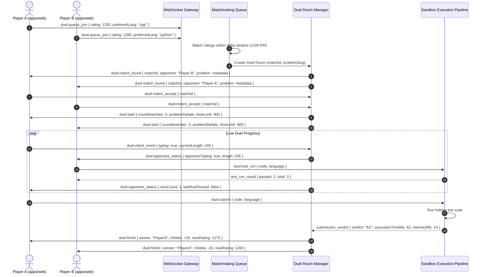

# BrackeT — System Architecture & Design Document

> **Platform Vision**: *"More than solving problems. Play the match."*  
> BrackeT transforms algorithmic practice into a high-stakes, real-time competitive battleground where developers sharpen their problem-solving instincts through head-to-head duels, ladder progression, and a modern in-browser coding arena.

---

## 1. Executive Summary & Core Concept

Traditional competitive programming and interview preparation platforms are solitary, asynchronous, and sterile. Developers solve problems in isolation without the pressure, pacing, and dynamic tension demanded by real-world technical interviews and coding competitions.

**BrackeT** reimagines this paradigm by introducing:
- **1v1 Rival Duels**: Matched players solve the same algorithmic challenge simultaneously with live opponent status synchronization and synchronized countdown clocks.
- **Ranked Rating (RR) Ladder**: An Elo-inspired tier progression system spanning Bronze to Champion, rewarding speed, clean code, and win consistency.
- **Split-Panel Coding Arena**: An in-browser IDE built with Monaco Editor, fluid multi-axis resizable panels (`react-resizable-panels`), multi-language compilation targets, and an integrated test runner console.
- **High-Aesthetic Cyberpunk Dark UI**: A dark-mode design system with fluid micro-animations (Framer Motion, Magic UI, Tailwind CSS v4) configured with tailored color tokens and responsive layouts.
- **Verified Platform Transparency**: Open-source monorepo architecture, dedicated About & Contact verification hub with interactive inquiry submission, helpline copy-to-clipboard utilities, and registered trade licensing.

---

## 2. Monorepo & System Architecture

BrackeT is engineered as an npm-workspaces monorepo designed to scale independently across frontend clients, API gateways, execution workers, and shared packages.

### 2.1 Workspace Structure

```
BrackeT/
├── apps/
│   ├── web/                     # React 19 + TypeScript + Vite 8 + Tailwind CSS v4 SPA
│   │   ├── src/
│   │   │   ├── assets/          # Brand logos, icons, temporary avatars
│   │   │   ├── components/      # UI primitives & Magic UI effects (35+ components)
│   │   │   ├── Firebase/        # Firebase App & Auth SDK configuration
│   │   │   ├── hooks/           # Custom React hooks
│   │   │   ├── Layouts/         # RootLayout (Navbar + Footer) & AuthLayout (cinematic)
│   │   │   ├── lib/             # Utility functions (cn / clsx / tailwind-merge)
│   │   │   ├── Pages/
│   │   │   │   ├── About/       # Platform mission, story, and ContactSection
│   │   │   │   ├── Authentication/ # Login and Registration pages
│   │   │   │   ├── HomePage/    # Hero, HowItWorks, RankSystem, Bento, Languages, FAQ
│   │   │   │   ├── Problems/    # Catalog, filter tabs, and ProblemDetails arena
│   │   │   │   └── Shared/      # Navbar, Footer, and ErrorPage
│   │   │   ├── Provider/        # AuthProvider (Firebase context & user state)
│   │   │   ├── Router/          # React Router v7 createBrowserRouter configuration
│   │   │   ├── App.tsx          # Root app component
│   │   │   ├── index.css        # Tailwind v4 theme, fonts, and animation tokens
│   │   │   └── main.tsx         # Client entrypoint
│   │   ├── public/              # Mock problem datasets, promo videos, and static assets
│   │   └── package.json
│   │
│   └── api/                     # Express 5 + TypeScript backend gateway & services
│       ├── src/
│       │   ├── app.ts           # Express app setup, CORS, JSON parsers
│       │   └── server.ts        # Server entrypoint and port binding
│       ├── tsconfig.json
│       └── package.json
│
├── packages/                    # Shared workspace libraries (future: types, judge-client)
├── design.md                    # System architecture & design specifications
├── progress.md                  # Development tracker & milestone roadmap
├── README.md                    # Project overview & quickstart guide
└── package.json                 # Root monorepo workspace configuration
```

### 2.2 System Architecture Diagram



---

## 3. Frontend Architecture (`apps/web`)

The frontend application delivers a high-framerate, latency-sensitive user experience with instant responsive resizing, smooth layout physics, and rich dark-mode visual elements.

### 3.1 Tech Stack & Core Libraries

| Technology | Role | Version |
| :--- | :--- | :--- |
| **React** | Reactive UI framework | `^19.2.8` |
| **TypeScript** | Type safety across components & domain models | `~6.0.2` |
| **Vite** | Build tool and development server | `^8.3.0` |
| **Tailwind CSS v4** | Utility-first CSS engine with inline theme tokens | `^4.3.3` |
| **React Router** | Client-side routing, loaders, and error boundaries | `^7.18.3` |
| **Monaco Editor** | Code editor powering the problem workspace | `^0.57.0` |
| **Framer Motion** | Physics-based micro-interactions and transitions | `^13.4.0` |
| **Firebase** | Authentication (Email/Password, Google OAuth) | `^12.19.0` |
| **React Resizable Panels** | Dual-axis fluid workspace split layouts | `^4.14.1` |
| **Radix UI Primitives** | Headless accessible UI components (Tabs, Accordion, Dropdowns) | `^2.x` |
| **Lucide & React Icons** | UI iconography | `^1.16.0` / `^5.5.0` |

### 3.2 Design System & Visual Tokens

The user interface follows a cyberpunk-infused dark aesthetic designed for ergonomic focus during intense coding sessions, accented with high-voltage neon highlights.

- **Theme Colors (`index.css`)**:
  - **Background (`--background`)**: `#0E1011` (Deep Obsidian Charcoal)
  - **Card / Surface (`--card`)**: `#061327` (Midnight Blue Slate)
  - **Primary (`--primary`)**: `#0052d8` (Cobalt Blue)
  - **Secondary (`--secondary`)**: `#4bc69d` (Neon Mint)
  - **Accent (`--accent`)**: `#dffb15` (Electric Volt Yellow)
  - **Foreground (`--foreground`)**: `#ffffff` (Pure White)
  - **Destructive (`--destructive`)**: `#dffb15` / `#ef4444` (High-contrast alert)
  - **Border (`--border`)**: `#0052d8` / `rgba(255, 255, 255, 0.1)`
- **Typography**:
  - **Body / Primary Sans**: `Montserrat`, sans-serif
  - **Headings**: `Hind Siliguri`, sans-serif
  - **Code & Accents**: `JetBrains Mono`, monospace
- **Custom Keyframe Animations**:
  - `aurora`: 8-second continuous multi-gradient mesh movement.
  - `meteor`: Angular streak animation with opacity fading.
  - `orbit`: Dual-ring circular orbital rotation for tech stack badges.
  - `blink-cursor`: Terminal cursor emulation.

### 3.3 Application Layouts

1. **Root Layout (`RootLayout`)**:
   - Header with brand Aurora logo, responsive navigation links (Home, Problem, Rival, Interview, About), interactive login/register action button or authenticated user profile avatar dropdown.
   - Dynamic `<Outlet />` mounting point for application pages.
   - Comprehensive footer with platform overview, legal links, and community channels.
2. **Authentication Layout (`AuthLayout`)**:
   - Split-screen cinematic design.
   - Left side: Dynamic glyph matrix canvas (`GlyphMatrix`), falling meteors (`Meteors`), and rotating typewriter badges.
   - Right side: Clean, focused container for Login and Registration forms.
3. **Workspace Layout (`ProblemDetails`)**:
   - Dedicated full-height application layout bypassing standard headers.
   - Custom 56px top action toolbar with problem timer, random problem shuffle, Run, Submit, and user session profile.
   - Responsive multi-axis split panes.

---

## 4. Detailed Page & Module Specifications

### 4.1 Landing Page Experience (`/`)

- **Hero Section (`Hero.tsx`)**:
  - Central value proposition with `HyperText` animated typography and radial gradient grid masking (`GridPattern`).
  - Interactive promo video modal (`HeroVideoDialog`) highlighted by `BorderBeam` glow.
  - Dual action CTAs linking directly to the problem catalog and platform showcase.
- **How It Works (`HowItWork.tsx`)**:
  - Three-stage visual workflow: **Queue** (instant matchmaking) → **Code** (timed battle) → **Climb** (earn RR).
  - Glowing step badges with text highlighting (`Highlighter`) and SVG `AnimatedBeam` connectors.
- **Rank Tier Showcase (`RankSystem.tsx`)**:
  - Interactive presentation of BrackeT's competitive ladder: Bronze, Silver, Gold, Platinum, Diamond, Master, Champion.
  - 3D-styled floating emblem with spring motion physics.
- **Language Showcase (`LanguageShowCase.tsx`)**:
  - Concentric dual-ring `OrbitingCircles` displaying supported languages (C++, Python, JavaScript, TypeScript, Go, Java, PHP, C).
- **Bento Features Grid (`BentoSection.tsx`)**:
  - Code in the Arena: Live typing terminal simulation (`Terminal`, `TypingAnimation`).
  - Live Match: Head-to-head avatar preview with VS clash effects.
  - Climb the Ladder: Real-time ranked rating bar showing progress toward tier promotion.
  - Every Match Counts: Streak history counter and performance statistics.
- **FAQ Section (`FAQSection.tsx`)**:
  - Collapsible accordion answering rules, anti-cheat detection, and Elo rating mathematics.

### 4.2 Problem Catalog (`/problems`)

- **Problem Banner (`ProblemBanner.tsx`)**:
  - Dynamic page header displaying platform statistics, daily challenge spotlight, and quick duel queue shortcut.
- **Topic Filter Tabs (`Tabs`)**:
  - Curated categorical navigation:
    - `All Topic`: Entire problem repository.
    - `Data Structure`: Arrays, Linked Lists, Trees, Graphs, Heaps, Hash Tables.
    - `Algorithm`: Dynamic Programming, Greedy, Binary Search, Two Pointers, Backtracking.
    - `Database`: SQL queries, schema indexing, joins, aggregations.
    - `Shell`: Bash scripting, pipeline processing, system utilities.
- **Search & Sort Controls**:
  - Live substring filtering by problem title and algorithm tag.
  - Filter modal and sort options (by rating, acceptance rate, title).
- **Problem Table (`ProblemList.tsx`)**:
  - Structured data table rendering problem title, numerical skill rating (e.g., 950 RR), topic tag badges, and historical community acceptance rate percentage.
  - Direct routing to `/problem/details/:slug`.
- **Data Provider**:
  - Client loader fetching structured problem manifests (`/mockProblems.json`), designed to seamlessly connect to `/api/problems`.

### 4.3 Problem Solving Arena (`/problem/details/:slug`)

The problem solving arena is BrackeT's central execution environment, designed for zero-distraction competitive coding.



- **Top Action Toolbar**:
  - Brand identity with Aurora text effect and quick return navigation.
  - Action controls: Stop-watch problem timer, random problem shuffle (`FaShuffle`), "Run" execution trigger (`FaPlay`), and "Submit" evaluation trigger (`VscCloudUpload`).
  - User session avatar and quick settings/profile dropdown.
- **Dual-Axis Nested Resizable Panels (`react-resizable-panels`)**:
  - **Horizontal Split**:
    - **Left Panel (Problem Statement)**:
      - Title, numerical rating badge, topic tag badges, acceptance rate.
      - Markdown-rendered problem description, input format, output format, and constraints.
      - Interactive expandable examples with copy-to-clipboard sample inputs and outputs.
      - Collapsible hints accordion for progressive assistance.
    - **Right Panel (Editor & Test Console)**:
      - **Vertical Split (Top: Code Editor)**:
        - Language selector supporting C++, Python, JavaScript, TypeScript, Java, and Go.
        - Dynamic starter code generation mapped to problem signature and selected language.
        - Action buttons for code formatting (`TbBraces`) and resetting starter code (`TbReload`).
        - Monaco Editor instance configured with `vs-dark`, smooth scrolling, custom font sizing, and line numbers.
      - **Vertical Split (Bottom: Test Suite Console)**:
        - Test case selector tabs (`Case 1`, `Case 2`, ...) populated from problem pretests/public cases.
        - Formatted input and expected output blocks.
        - Extensible structure for runtime output, execution time (ms), memory footprint, and test assertion diffs.

### 4.4 About & Verification Page (`/about`)

The About page serves as BrackeT's official platform identity, credibility hub, and community contact center.

- **Brand Story & Narrative**:
  - Explains the origin of BrackeT and why competitive esports mechanics solve traditional interview preparation fatigue.
  - Highlights the transition from solitary problem-solving to live head-to-head match tension.
- **Three Core Pillars Grid**:
  - **The Mission**: Empower developers to build unshakable problem-solving reflexes and eliminate interview anxiety through real-time challenge.
  - **The Vision**: A global digital colosseum where algorithms meet sportsmanship, rated fairly by Elo logic and transparent execution.
  - **Verified Credentials**: Open-source monorepo architecture, public issue tracking, and registered Trade License `#124154`.
- **Direct Support & Contact Channels (`ContactSection.tsx`)**:
  - **Direct Support Email**: `support@bracket.io` with 1-click clipboard copy utility and 24-business-hour response SLA commitment.
  - **Helpline Numbers**: Multiple direct phone contact lines with individual copy-to-clipboard actions and designated business hours (10:00 AM – 5:00 PM BST).
  - **Platform Registry Card**: Registered Trade License `#124154` and current software build status (`Beta v0.0.1`).
  - **Interactive Inquiry Form**:
    - Client-side validation for name, email format, category, and minimum message length.
    - Categories: General Inquiry & Feedback, Arena / Duel Bug Report, Problem Statement Suggestion, Partnership or Sponsorship, Account & Authentication Support.
    - Asynchronous submission simulation with spinner feedback and animated success confirmation state (`CheckCircle2`).
  - **Full-Width 5-Column Social Network Grid**:
    - High-visibility links with micro-hover scaling for GitHub, Facebook, LinkedIn, Instagram, and YouTube.

### 4.5 Authentication & User Management

- Handled via Firebase Authentication with centralized React context (`AuthProvider`).
- Supported providers: Email + Password and Google One-Tap/Popup sign-in.
- State persists across page refreshes with real-time auth state observer (`onAuthStateChanged`).
- Dedicated `AuthLayout` with decorative canvas visual effects (`GlyphMatrix`, `Meteors`).

---

## 5. Backend & Real-Time Duel Architecture (`apps/api`)

### 5.1 API Gateway Structure

The backend runs an Express server in TypeScript with CORS and JSON parsing enabled, structured to serve:
- `GET /api/problems`: Problem catalog list with pagination, filtering, and tag search.
- `GET /api/problems/:slug`: Complete problem statement, constraints, public test cases, and starter code templates.
- `POST /api/auth/verify`: Firebase ID token verification and user profile synchronization.
- `POST /api/submissions/run`: Evaluate user code against public/pretest cases without affecting rating.
- `POST /api/submissions/submit`: Evaluate user code against full hidden test suite, update problem solved state and rating.
- `GET /api/leaderboard`: Global and tiered player rankings.

### 5.2 Real-Time 1v1 Rival Duel Protocol



### 5.3 Rating Model (Ranked Rating - RR)

BrackeT employs an Elo-derived rating algorithm customized for coding competitions:
- **Base Expected Score ($E_A$)**:
  $$E_A = \frac{1}{1 + 10^{(R_B - R_A) / 400}}$$
- **New Rating Calculation**:
  $$R_A' = R_A + K \cdot (S_A - E_A) + B_{speed} + B_{accuracy}$$
  - $K$: Scaling factor ($K = 32$ for provisional/new players, $K = 16$ for veteran tiers).
  - $S_A$: Actual outcome ($1$ for Win, $0.5$ for Draw, $0$ for Loss).
  - $B_{speed}$: Bonus points awarded for fast submissions within the first $30\%$ of the match duration.
  - $B_{accuracy}$: Bonus points awarded if the problem is solved on the very first submission attempt with zero failed runs.

#### Competitive Tiers:
| Tier Name | Rating Range (RR) | Badge Visual Theme |
| :--- | :--- | :--- |
| **Bronze** | $0 - 799$ | Rust Bronze |
| **Silver** | $800 - 1199$ | Slate Silver |
| **Gold** | $1200 - 1499$ | Electric Volt Accent |
| **Platinum** | $1500 - 1799$ | Cyan Platinum |
| **Diamond** | $1800 - 2099$ | Cobalt Blue Primary |
| **Master** | $2100 - 2399$ | Deep Amethyst Violet |
| **Champion** | $2400+$ | Aurora Prismatic Glow |

---

## 6. Sandboxed Code Execution Pipeline

To run untrusted user-submitted code securely and deterministically, BrackeT utilizes an isolated micro-container sandbox pipeline (via Judge0 or custom Docker/Linux `nsjail`/`isolate` workers).

```
                      +-----------------------------+
                      |   Submission Intake API     |
                      +--------------+--------------+
                                     |
                                     v
                      +-----------------------------+
                      |   Redis BullMQ Queue        |
                      +--------------+--------------+
                                     |
                 +-------------------+-------------------+
                 |                                       |
                 v                                       v
    +------------------------+              +------------------------+
    | Execution Worker 01    |              | Execution Worker 02    |
    | (Ephemeral Docker)     |              | (Ephemeral Docker)     |
    +-----------+------------+              +-----------+------------+
                |                                       |
                +-------------------+-------------------+
                                    |
                                    v
                      +-----------------------------+
                      |   Result & Verdict Verifier |
                      +--------------+--------------+
                                     |
                                     v
                      +-----------------------------+
                      |   WebSocket / REST Dispatch |
                      +-----------------------------+
```

### 6.1 Resource Constraints & Environment Limits

| Parameter | Standard Limit | Language Multipliers / Notes |
| :--- | :--- | :--- |
| **CPU Time Limit** | $1.0\text{ s}$ baseline | $\times 2$ for Java, $\times 3$ for Python |
| **Memory Limit** | $256\text{ MB}$ | Enforced via cgroups `memory.max` |
| **Process Limit** | Max 10 PID | Prevents fork-bomb denial-of-service |
| **Disk Write Limit** | $16\text{ MB}$ (ephemeral `/tmp`) | Readonly root filesystem |
| **Network Access** | Completely Disabled | `network: none` isolated namespace |

### 6.2 Compilation & Runtime Matrix

| Language | Target / Compiler | Version | Compilation Command | Execution Command |
| :--- | :--- | :--- | :--- | :--- |
| **C++** | GCC / G++ | 14.x | `g++ -O3 -std=c++20 solution.cpp -o solution` | `./solution` |
| **Python** | CPython | 3.12.x | None (Syntax checked) | `python3 solution.py` |
| **JavaScript** | Node.js / V8 | 22.x LTS | None (Syntax checked) | `node solution.js` |
| **TypeScript** | tsx / esbuild | 5.x | `esbuild solution.ts --bundle --outfile=out.js` | `node out.js` |
| **Java** | OpenJDK | 21 LTS | `javac Solution.java` | `java -Xmx256m Solution` |
| **Go** | Go Toolchain | 1.23.x | `go build -o solution solution.go` | `./solution` |

### 6.3 Verdict Classification System

- `AC` (**Accepted**): All test cases passed within time and memory boundaries.
- `WA` (**Wrong Answer**): Solution produced output differing from expected output.
- `TLE` (**Time Limit Exceeded**): Code ran longer than allocated CPU execution duration.
- `MLE` (**Memory Limit Exceeded**): Memory allocation exceeded the $256\text{ MB}$ limit.
- `RTE` (**Runtime Error**): Non-zero exit code (uncaught exception, segfault, out of bounds).
- `CE` (**Compilation Error**): Syntax error or missing symbol during compile phase.

---

## 7. Data Models & Entity Schemas

### 7.1 Problem Entity (`Problem`)

```typescript
interface ProblemStatement {
  description: string;       // Markdown description text
  inputFormat: string;       // Specifications for stdin
  outputFormat: string;      // Specifications for stdout
  notes?: string;            // Additional clarification
  images?: string[];         // Explanatory diagram URLs
}

interface TestCase {
  input: string;             // Stdin input string
  output: string;            // Expected stdout string
  explanation?: string;      // Optional explanation for example cases
}

interface Problem {
  id: string;                // Unique identifier (e.g. "p1")
  slug: string;              // URL-friendly slug (e.g. "maximum-subarray")
  title: string;             // Display title
  rating: number;            // Difficulty rating (e.g. 950)
  tags: string[];            // ["array", "dp", "kadane"]
  statement: ProblemStatement;
  constraints: string[];     // ["1 <= n <= 1e5", "-1e4 <= nums[i] <= 1e4"]
  timeLimitMs: number;       // Default execution timeout (e.g. 1000)
  memoryLimitMb: number;     // Memory cap (e.g. 256)
  languageTimeMultiplier: Record<string, number>; // e.g. { python: 3, java: 2 }
  examples: TestCase[];      // Shown on problem description panel
  testCases: {
    public: TestCase[];      // Used in Test Suite sample tabs
    pretests: TestCase[];    // Evaluated during "Run" button action
    hidden: TestCase[];      // Evaluated only during "Submit" button action
  };
  allowedLanguages: string[]; // ["cpp", "python", "javascript", "java", "go"]
  starterCode: Record<string, string>; // Boilerplate code per language
  hints?: string[];          // Progressive hint disclosures
}
```

### 7.2 User Entity (`User`)

```typescript
interface UserProfile {
  uid: string;               // Firebase Authentication UID
  email: string;             // Registered email address
  displayName: string;       // Display username / gamer tag
  photoURL?: string;         // Profile avatar URL
  rating: number;            // Current Ranked Rating (RR), default 1000
  tier: "Bronze" | "Silver" | "Gold" | "Platinum" | "Diamond" | "Master" | "Champion";
  highestRating: number;     // All-time peak rating
  stats: {
    matchesPlayed: number;
    matchesWon: number;
    matchesLost: number;
    currentStreak: number;
    longestStreak: number;
    problemsSolved: number;
  };
  createdAt: string;
  updatedAt: string;
}
```

### 7.3 Submission Entity (`Submission`)

```typescript
interface Submission {
  submissionId: string;
  userId: string;
  problemSlug: string;
  language: string;
  code: string;
  mode: "run" | "submit" | "duel";
  verdict: "AC" | "WA" | "TLE" | "MLE" | "RTE" | "CE" | "PENDING";
  executionTimeMs: number;
  memoryUsedMb: number;
  passedTests: number;
  totalTests: number;
  compileError?: string;
  matchId?: string;          // If submitted during a 1v1 duel
  createdAt: string;
}
```

---

## 8. Security & Performance Considerations

1. **Frontend Optimization**:
   - Monaco Editor lazy loaded and bundle-split via dynamic imports.
   - Tailored asset pipeline using optimized SVG and WebP graphics.
   - Client-side navigation powered by React Router v7 with hydrated fallbacks (`pageLoader.tsx`).
2. **Backend & Sandbox Security**:
   - Unprivileged Docker containers with `--cap-drop=ALL` and readonly root filesystem.
   - No internet access permitted inside sandbox containers.
   - Aggressive timeout watchdogs killing stalled child processes.
   - Rate limiting on compilation endpoints to prevent abuse.
   - Strict input validation and HTML sanitization on inquiry forms and markdown rendering.
3. **Authentication & Identity Security**:
   - Token-based Firebase authentication validated server-side on all privileged API endpoints.
   - Persistent session storage without exposing sensitive credentials.
